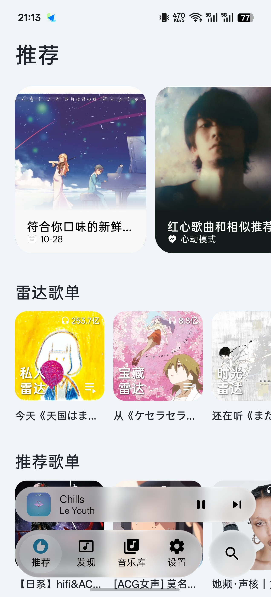
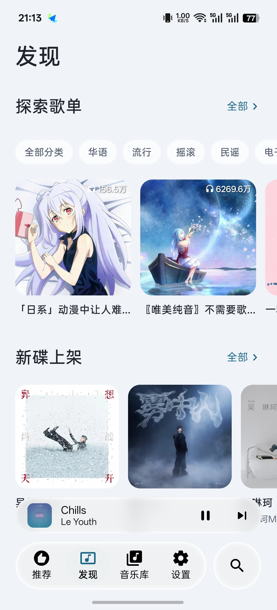
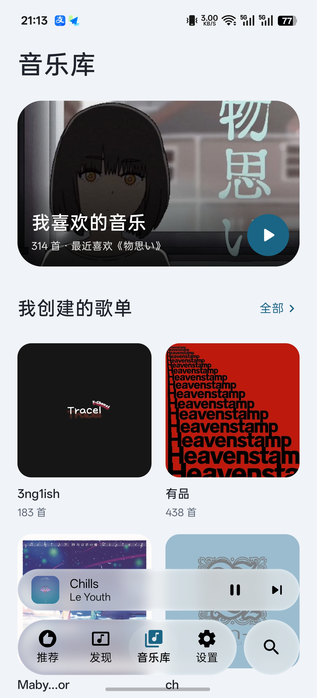
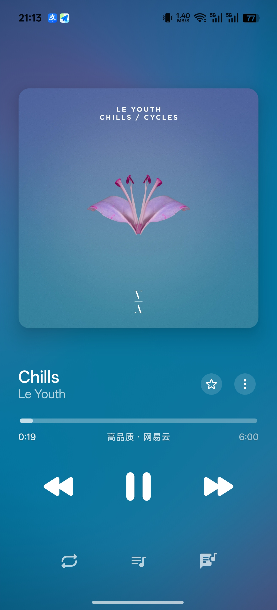
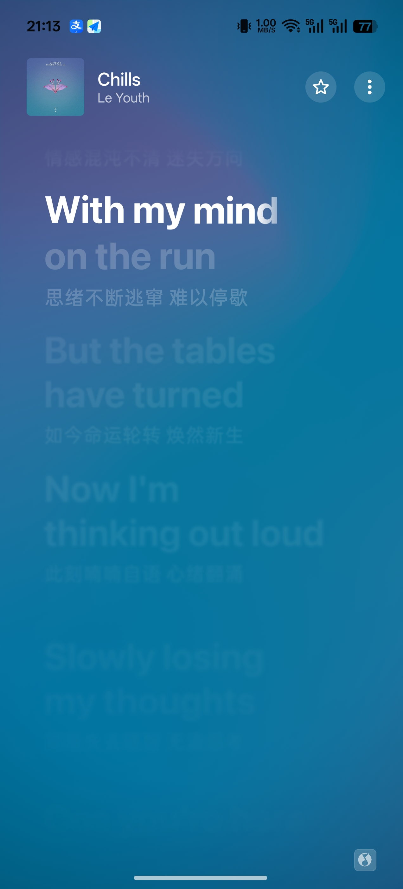
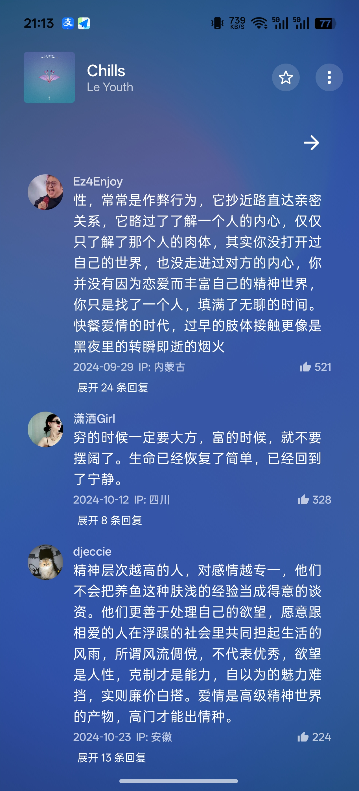
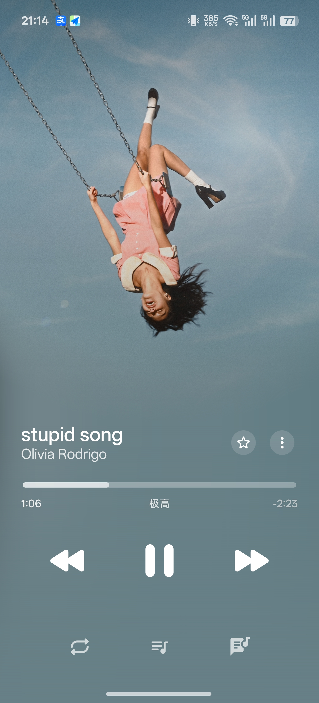
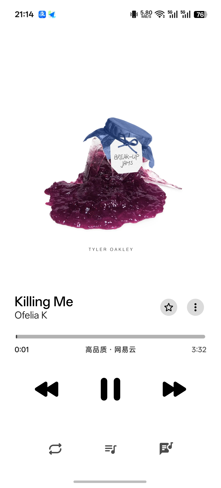
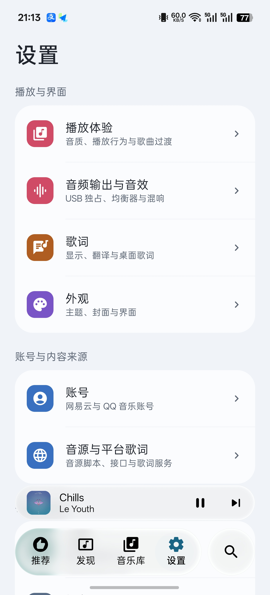

<div align="center">

# Mei

### 一个第三方网易云播放器


</div>

---
## 项目介绍

Mei 是一款使用 **Jetpack Compose** 开发的 **网易云音乐第三方客户端**。

## 登录说明

推荐在“设置 → 内容设置”中选择 **扫码登录**，使用网易云音乐 App 扫描二维码并在手机上确认即可。
只有一台设备时，也可以先截图二维码，再到网易云音乐 App 的扫一扫中从相册识别。

### 手动 Cookie 登录

如果扫码暂时不可用，仍可手动填写 Cookie：
* 只需要 `MUSIC_U` 字段的 **值**
* ⚠️ 仅保留纯值 `xxxxx`，不要包含 `cookie=`, `MUSIC_U=`, `;`, `空格`, `其它字段` 等内容

正确示例：

```
xxxxx（仅纯值）
```

❌ 以下仍然**错误**的：
```
cookie=MUSIC_U=xxxxx
MUSIC_U=xxxxx
cookie: MUSIC_U=xxxxx;
```

### 获取方式

1. 通过 **网页版登录网易云**
2. 打开浏览器开发者工具（F12）
3. 在任意请求的 Request Header 中找到 `MUSIC_U`
4. 复制它的 **纯值** 即可
5. Cookie 一般长期有效，无需频繁更新

---


## 开源致谢

感谢以下几位开源圣人：

* 提供高质量歌词库 [amll-ttml-db](https://github.com/Steve-xmh/amll-ttml-db)
* 提供精美歌词组件 [accompanist-lyrics-ui](https://github.com/6xingyv/accompanist-lyrics-ui.git)
* 提供qrc解密算法 [qrcDecrypt](https://github.com/TLittlePrince/qrcDecrypt)
* 智能过渡使用 [BeatNet](https://github.com/mjhydri/BeatNet) 模型识别节拍与小节强拍；模型署名和转换说明见 [THIRD_PARTY_NOTICES](THIRD_PARTY_NOTICES)

Mei 的应用代码沿用 [Apache License 2.0](LICENSE)。


## 软件界面预览
<table>
  <tr>
    <td></td>
    <td></td>
    <td></td>
  </tr>
  <tr>
    <td></td>
    <td></td>
    <td></td>
  </tr>
  <tr>
    <td></td>
    <td></td>
    <td></td>
  </tr>
</table>

---

## 写在最后
好久没有更新，希望有人能喜欢。但如果你读到这里，谢谢你。

Mei 还在写、还能听歌、歌词还能逐字滚动、感情虽然滚动不了了但代码还能动。让我们坚信，**我们终将相遇**。

Mei 2026(梅)

---
