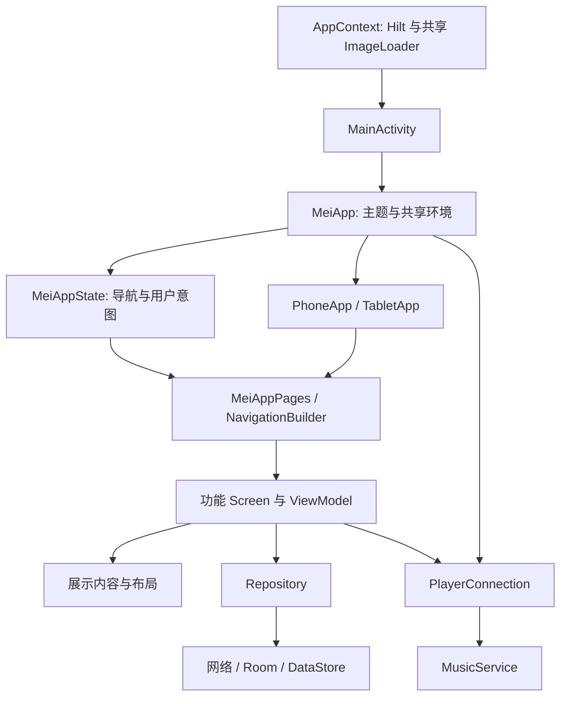

# Mei 整体架构与修改入口

本文面向首次接手项目的开发者与 agent，描述当前工作树的实际结构，并说明新增功能应接入的位置。更新于 2026-10-29。

先读 [AGENTS.md](../AGENTS.md)，再根据本文找到专题文档和源码。项目处于渐进重构中：歌单已经建立独立的展示边界，其他页面并未全部采用相同结构；文档中的后续约定不代表所有旧代码已经迁移。开始任务时核对所在分支与工作区，不根据文档推断某项修改已经合入 main。

## 1. 先找到修改入口

源码根目录为 `app/src/main/java/com/ljyh/mei/`。下表中的源码路径均相对此目录。

| 任务 | 优先阅读的位置 | 说明 |
| --- | --- | --- |
| 应用启动、主题、共享环境 | `MainActivity.kt`、`AppContext.kt`、`ui/app/MeiApp.kt` | Activity、Application 与 Compose 装配各有生命周期 |
| 手机／平板外层、底栏、搜索与输入法避让 | `ui/app/PhoneApp.kt`、`ui/tablet/TabletApp.kt` | 两种外层各自布局，导航与用户意图共享 |
| 页面注册、参数、返回栈 | `ui/screen/Screen.kt`、`NavigationBuilder.kt`、`PageDestination.kt` | 同一业务目的地共用路由 |
| 页面数据与操作 | 对应功能的 Screen、ViewModel、Repository | 先核对现有状态所有者，再调整边界 |
| 歌单双栏、排序、位置或下载确认 | `ui/screen/playlist/` | 见 [歌单架构](playlist-detail-architecture.md) |
| 顶栏、内容边距、集合页框架 | `ui/component/glass/`、`layout/`、`collection/` | 复用公共容器及安全区规则 |
| 接口与响应解析 | `data/repository/`、`data/network/`、`data/model/` | 路径、协议和模型一起核对 |
| 本地库、历史、下载记录 | `di/AppDatabase.kt`、`di/dao/`、`di/repository/` | 检查迁移与数据所有权 |
| 播放、队列、音源或音效 | `playback/` | 页面通过播放连接消费服务状态 |
| 图片请求、缓存与封面取色 | `utils/image/`、`AppContext.kt`、`di/repository/LibraryRepository.kt` | 后者文件内定义 `ColorRepository` 等类，文件名不等于单一职责 |
| 设置项及偏好持久化 | `constants/`、`utils/preferences/`、`ui/screen/setting/` | 先找已有 key、偏好封装及消费入口 |
| 原生 USB 输出、节拍分析 | `playback/usb/`、`playback/transition/`、`app/src/main/rust/`、`app/src/main/cpp/` | 同时检查 Kotlin 与原生边界 |

## 2. 工程与目录

工程使用 Kotlin、Jetpack Compose、Hilt、Media3、Room、Paging、DataStore 和 kotlinx.serialization。Gradle 使用 Kotlin DSL；依赖版本与别名集中在 [libs.versions.toml](../gradle/libs.versions.toml)。

[settings.gradle.kts](../settings.gradle.kts) 注册 `app` 与 `UnblockNeteaseMusic` 两个 Gradle 模块。手机和平板 UI 都在 `app` 中，不是两个应用模块。Rust USB 驱动和 C++ BeatNet 组件由应用的原生构建接入，也不是独立的 UI 模块。

| 目录 | 当前职责 |
| --- | --- |
| `ui/app/` | 共享应用状态、导航容器、页面集合接口及手机外层 |
| `ui/tablet/` | 平板外层、底栏组件、播放器接入与页面集合扩展点 |
| `ui/screen/<feature>/` | 功能页面、ViewModel 与页面专用状态持有者 |
| `ui/component/` | 跨页面共享的卡片、歌曲行、顶栏、弹层、播放器等 |
| `ui/model/`、`ui/local/`、`ui/theme/`、`ui/motion/` | 展示模型、CompositionLocal、主题及动画策略 |
| `data/repository/` | 业务数据获取与组合，包含远端及共享缓存相关逻辑 |
| `data/network/` | 网络传输、协议封装、服务接口与解析入口 |
| `data/model/` | 按接口、领域与 Room 等用途组织的数据模型，分类尚未完全统一 |
| `data/paging/` | 已提取的分页数据源；并非全项目分页都已迁入 |
| `di/`、`di/dao/`、`di/repository/` | Hilt 装配、Room 定义及已有本地数据仓库 |
| `playback/` | 播放服务、连接、队列、音源、USB、歌词悬浮窗、音效及智能过渡 |
| `download/` | 下载入队、后台 Worker 与文件处理 |
| `utils/`、`constants/` | 已有专项工具与偏好定义；新增逻辑先找对应功能入口 |

`data/repository/` 与 `di/repository/` 是历史形成的并存结构。修改任务不要求先搬完所有仓库，也不要因目录名相似再建一个重复实现。新增内容按实际职责归属，必要的迁移单独说明调用方影响。

`tools/reverse-engineering/`、外部 `api-enhanced` 及其他参考项目用于研究。应用行为以 `app/` 内实现为准，研究样本不成为运行依赖。

## 3. 启动与运行关系



图中表示装配与主要调用关系，不要求所有旧页面都只能沿一条固定链路访问数据。

- [AppContext](../app/src/main/java/com/ljyh/mei/AppContext.kt) 是 Hilt Application，建立共享图片加载器，并执行账号、喜欢歌曲及动态封面相关的启动工作。
- [MainActivity](../app/src/main/java/com/ljyh/mei/MainActivity.kt) 配置系统边缘绘制、日志、设备初始化与启动参数，进入 `MeiApp`。
- [MeiApp](../app/src/main/java/com/ljyh/mei/ui/app/MeiApp.kt) 建立主题、播放连接、共享 CompositionLocal，并决定应用外层布局。
- `MeiAppState` 是 Compose 状态持有者，包含导航控制器、搜索意图、主导航选中项和播放器展开锚点；它不是业务 ViewModel，也不拥有播放器引擎。

## 4. UI 的三个决策层

### 应用外层：底栏和全屏层如何放置

`MeiApp` 测量扣除左右系统安全区后的可用宽度，通过 `AppWindowLayout` 选择紧凑或宽布局，当前断点为 600dp。

`PhoneApp` 与 `TabletApp` 分别管理自己的底栏、搜索焦点、IME 避让和播放器几何。`MeiPageLayout` 跟随外层选择提供 20dp／28dp 公共内容边距。不要在每个页面重新计算一套手机／平板分类来决定公共边距。

### 页面集合：某个功能是否需要另一套内容结构

`MeiAppPages` 承载共享 NavHost，`NavigationBuilder` 统一注册目的地与参数。`MeiPageContent` 定义当前可替换的页面入口；`TabletPageContent` 已覆盖音乐库、歌手、专辑、搜索和设置等入口，其余方法委托共享实现。

并非所有目的地都已经通过 `MeiPageContent` 接入；`NavigationBuilder` 中仍有直接装配的页面。改造某个目的地时按需要补入口，不复制整份路由图。

独立平板页面共用原目的地与导航 entry 的业务作用域。音乐库、歌手和专辑由业务入口将展示状态与操作回调交给独立内容函数，数据加载、播放队列与账号状态继续复用原实现；文件边界见 [平板内容页](tablet-content-pages.md)。

### 页面内部：同一个功能如何利用当前空间

歌单进入同一个 `PlaylistScreen`。它接入业务状态与操作，`PlaylistContent` 接收展示数据和回调，再按自身实际宽度与字体选择 `SinglePanePlaylistLayout` 或 `TwoPanePlaylistLayout`，普通字体下双栏起点为 840dp。

600dp 与 840dp 分别服务应用底栏和内容分栏；音乐库、歌手和专辑的两栏也以 840dp 为普通字体起点，并随字体增大提高所需宽度。出现宽底栏配单栏歌单是有效组合。只有排列不同的页面可在内容层适配；确实存在内容结构差异的页面再由页面集合接入独立实现。细节见 [平板架构](tablet-ui.md)。

新增页面专用布局放在对应功能内的 `layout/`，具体控件放在 `component/`。不要机械给每个页面都生成 Phone／Tablet 转发文件，也不要把排序模型、缓存和数据源一起归进含义不明的 `state/`。

## 5. 状态与任务归属

| 状态或任务 | 当前归属与恢复方式 | 边界 |
| --- | --- | --- |
| 主导航、全局搜索、播放器展开意图 | `MeiAppState`；其中需保存的字段使用 `rememberSaveable`，返回栈由导航保存机制负责 | 播放连接需重新绑定，不能把旧服务对象写入保存状态 |
| 页面请求、排序或下载准备任务 | 功能 ViewModel／其持有的控制器，运行于 `viewModelScope` | 配置重建可继续任务；进程消失后需按保存的意图重建，不能恢复原协程 |
| 需要恢复的筛选、查询、编辑意图 | 小型字段存入 `SavedStateHandle` 或 `rememberSaveable` | 只保存可恢复所需的 ID、参数和偏移，不保存临时 URL、大量元数据或运行中对象 |
| 即时菜单、焦点、动画过程 | 组件局部状态 | 是否保存由具体交互决定，普通 `remember` 不承诺 Activity 重建后恢复 |
| 播放引擎、当前队列、音频处理 | `MusicService` 及播放控制器 | 播放持续性与页面组合生命周期分开处理 |
| 后台下载 | `DownloadManager`、WorkManager、Room 下载记录 | 入队成功与文件下载完成是两个阶段 |
| 长期用户数据和设置 | Room、DataStore | 不以页面保存状态代替持久数据 |

导航内容的 `movableContentOf` 持有者位于外层布局选择之外，同一次组合中切换外层时保留页面组合。播放器展开锚点同样在外层持有，供两套几何不同的 sheet 使用。Activity 重建后，仍由导航、可保存状态、ViewModel 和服务各自负责恢复，不能推导为所有页面字段都能保留。

歌单是状态拆分的参考案例：搜索和排序草稿由 ViewModel 管理；列表保存歌曲 ID、序号和偏移，避免单双栏头部索引不同造成错位；下载确认保存选曲意图，恢复到待确认阶段，不自动重复提交。见 [歌单架构](playlist-detail-architecture.md)。

## 6. 数据、协议与持久化

业务接口主要由 `data/repository/` 下的仓库调用 `data/network/api/` 的服务。`NetworkModule` 装配 Ktor／OkHttp 与 kotlinx.serialization 的 Json；网易云传输、加密和响应处理由 `NeteaseHttp`、`XeApiClient` 等已有入口负责。`RepositoryModule` 及构造注入共同完成仓库装配。

修改接口时一起核对调用方、请求路径、参数、协议与响应模型。`ApiService`、`EApiService`、`WeApiService` 的名称不构成可随意互换协议的依据。沿用现有 `Resource` 和错误处理方式，取消行为也要明确。

Room 的实体在 `data/model/room/`，DAO 在 `di/dao/`，数据库声明与迁移在 [AppDatabase.kt](../app/src/main/java/com/ljyh/mei/di/AppDatabase.kt)。修改表结构时检查已发布版本的迁移链；DataStore 的公共封装在 `utils/preferences/`，key 多在 `constants/`。

不要把 Cookie、令牌、抓包设备标识写进源码、测试或文档。协议参考与应用实现分别维护，新增接口优先接入现有网络与序列化入口。

## 7. 播放与共享资源

[MusicService](../app/src/main/java/com/ljyh/mei/playback/MusicService.kt) 是 Media3 `MediaLibraryService`，装配播放器、媒体会话、队列与音频相关控制器。

应用内的 `rememberPlayerConnection` 通过绑定服务取得 `MusicBinder`，创建 [PlayerConnection](../app/src/main/java/com/ljyh/mei/playback/PlayerConnection.kt)。后者暴露播放状态和队列操作，页面通过共享连接发起播放；它不是仅由 `MediaController` 封装出来的远端代理。

| 区域 | 修改入口 |
| --- | --- |
| 队列与来源、恢复快照 | `playback/queue/` |
| 音频地址、本地／缓存与备用音源解析 | `playback/source/`、`data/repository/PlayerRepository.kt` |
| 均衡器、混响、限制器 | `playback/equalizer/` |
| 智能过渡与节拍分析 | `playback/transition/` |
| USB 权限、输出状态与 JNI 调用 | `playback/usb/` 及播放根目录的输出适配 |
| 歌词加载、桌面窗口与系统歌词发布 | `playback/lyrics/`；服务持有 `PlaybackLyricsController`，共享获取与合并在 `utils/lyric/LyricManager.kt`；[ColorOS 接入](coloros-lockscreen-lyrics.md) |
| 下载准备与后台执行 | 页面任务持有者 → `download/DownloadManager.kt` → `DownloadWorker` |

手机与平板播放器从共享 `PlayerHost` 绑定当前播放状态与弹层；平板展示独立位于 `ui/tablet/player/`，具体入口、视觉复用和恢复边界见 [平板播放器](tablet-player.md)。

歌词与下一首封面等预加载由播放侧触发，进入共享数据源或缓存；页面消费结果。修改手机或平板显示不应另建播放器、歌词管理器或图片加载器。

图片统一使用 `AppContext` 提供的 Coil ImageLoader，普通 UI 将 URL 交给现有组件；`ArtworkRequestInterceptor` 与 `ImageUrls.kt` 统一处理尺寸。播放器高清封面有明确的专用入口。详见 [图片加载](image-loading.md)，不要在页面散落 CDN 参数或额外建立缓存键。

USB Rust 工程位于 `app/src/main/rust/mei-usb-core/`；C++ 原生入口在 `app/src/main/cpp/`。修改前阅读 [Rust USB 说明](../app/src/main/rust/mei-usb-core/README.md) 和当前 CMake／Gradle 接线，按实际参与构建的文件判断，保留来源与许可说明。

## 8. 常见改动的接入顺序

**新增一个独立列表或详情页：** 先确定数据所有者与导航作用域，在 `Screen`／`NavigationBuilder` 注册真实目的地；页面入口接入 ViewModel 和操作，展示组件接收数据及回调。完整集合优先检查 `MeiCollectionPage`，封面内容优先检查 `ArtworkCard`／`PlaylistCard`。不要为一个新集合复制整套页面框架。

**为现有功能增加平板结构：** 先判断只是尺寸排列变化，还是内容组织不同。前者在功能内容层按可用宽度处理，后者通过 `MeiPageContent`／`TabletPageContent` 接入；两者都复用原导航和业务数据。测试窗口缩放、重建、返回栈及位置语义，不只检查横屏分支。

**增加一个设置：** 找现有偏好 key 与封装，明确真正的消费位置；设置页面只编辑偏好，播放侧执行音效、音源或输出变化。确认默认值、旧值兼容及生效时机。

**调整底栏或顶栏：** 先核对 AGENTS.md 的 UI 范围，再检查公共材质、`MeiPageLayout`、`LocalPlayerAwareWindowInsets` 和所属外层；系统安全区与 IME 避让明确由哪层消费，避免重复 padding。近期平板实现与旧专题说明可能包含过渡行为，不能据此扩大 AGENTS.md 规定的材质范围。

**修改公共边界：** 在同次改动更新调用方、相关测试及对应专题文档。总览保留层次与修改入口，具体算法、参数和交互细节留在专题文档，减少多处复制后失效。

## 9. 当前限制与验证

- 新旧页面结构并存，尚未全面实现“业务入口 + 纯展示内容”的边界；歌单可作为迁移样例，不能据此假定其他页面已解耦。
- `MeiPageContent` 不是完整路由表；外层窗口判断已统一，其他页面仍有旧 `DeviceInfo` 判断，按功能逐步处理。
- 歌单远处歌曲的锚点恢复仍按顺序请求分页，较远位置可能等待较久。
- 原生输出、真实网络下载和所有页面的系统重建行为，不能由 UI 编译或少数状态测试证明。

验证按修改范围选择；纯文档变更核对链接与源码一致性即可。

```sh
# UI 或 Kotlin 改动的编译检查
./gradlew :app:compileDebugKotlin

# 示例：应用外层与歌单状态行为的定向回归
./gradlew :app:testDebugUnitTest --tests 'com.ljyh.mei.ui.app.*' --tests 'com.ljyh.mei.ui.screen.playlist.*'
```

测试在 `app/src/test/` 与 `app/src/androidTest/`。前者含 JVM／Robolectric 测试，后者依赖 Android 测试环境；不要把定向 JVM 测试表述成真机验收。音源、原生或协议变化另运行对应模块的定向检查。按协作约定不主动安装／更新 APK，不做视觉测试。

## 10. 专题索引

| 主题 | 文档 |
| --- | --- |
| 协作与当前 UI 约束 | [AGENTS.md](../AGENTS.md) |
| 平板外层与页面接入 | [tablet-ui.md](tablet-ui.md) |
| 平板全屏播放器、共享状态与面板 | [tablet-player.md](tablet-player.md) |
| 音乐库、歌手与专辑的平板内容边界 | [tablet-content-pages.md](tablet-content-pages.md) |
| 歌单展示、布局与状态恢复 | [playlist-detail-architecture.md](playlist-detail-architecture.md) |
| 综合搜索、分类分页与结果状态 | [search-results.md](search-results.md) |
| 完整集合页与公共卡片 | [collection-pages.md](collection-pages.md) |
| UI 边距、顶栏与材质背景 | [ui-chrome-alignment.md](ui-chrome-alignment.md)，范围以 AGENTS.md 为准 |
| 页面转场 | [page-navigation-motion.md](page-navigation-motion.md) |
| 图片请求与缓存 | [image-loading.md](image-loading.md) |
| 封面底色匹配 | [cover-background-matching.md](cover-background-matching.md) |
| LX 备用音源 | [lx-sources.md](lx-sources.md) |
| 链接分享 | [media-sharing.md](media-sharing.md) |
| 测试包与正式发布 | [beta-build.md](beta-build.md)、[release-build.md](release-build.md) |

Beta Build 与 Release 是不同工作流；正式发布工作流会创建／发布 Release。构建、推送、触发 Actions 与正式发布分别按用户授权执行，不因阅读本文自动启动。
